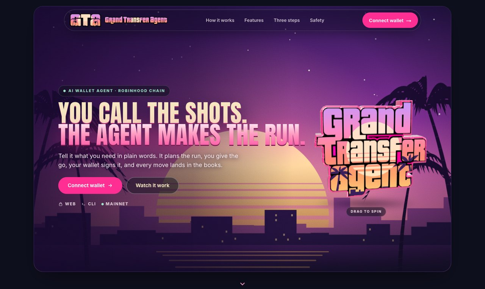
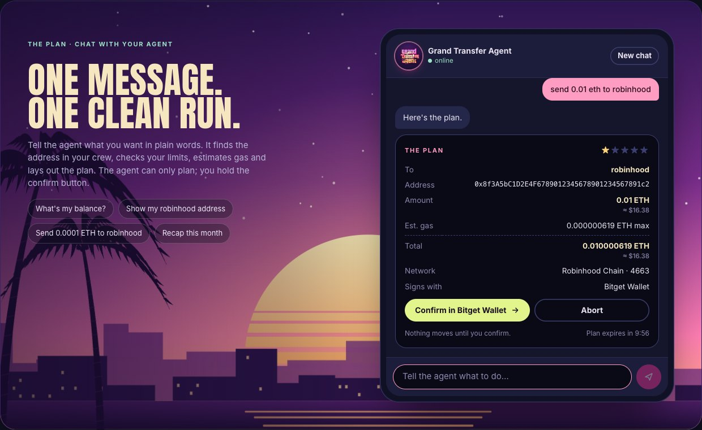
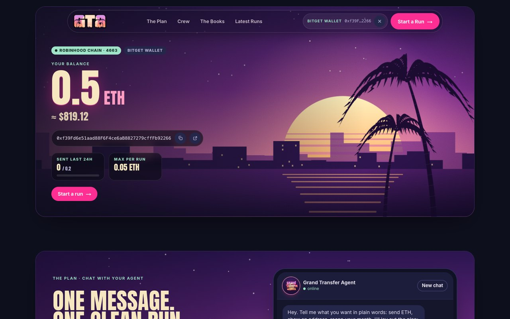

<p align="center">
  
</p>

<p align="center">
  <strong>You call the shots. The agent makes the run.</strong><br>
  An AI wallet agent for Robinhood Chain.<br><br>
  <a href="https://grandtransfer.agency"><strong>grandtransfer.agency</strong></a> ·
  <a href="https://x.com/grandtransferHQ">X @grandtransferHQ</a> ·
  <a href="https://www.npmjs.com/package/grand-transfer-agent">npm</a>
</p>



# Grand Transfer Agent

An AI wallet agent for **Robinhood Chain** (mainnet, chain ID 4663). You type what you want, for example "send 0.01 ETH to robinhood". The agent looks up the address and checks your limits, then shows you a plan. Nothing moves until you confirm it.

| Chat to plan a run                                                        | Your dashboard                                           |
| ------------------------------------------------------------------------- | -------------------------------------------------------- |
|  |  |

<sub>Screenshots use demo data: a public test wallet and an example recipient.</sub>

- **Send ETH by chat.** The agent prepares a plan with the recipient (name and full address), the amount, the estimated gas and a "wanted level". You confirm it, and the send is signed.
- **Crew (contacts).** Save addresses by name, then ask for "my robinhood address" or send by name.
- **The Books.** Incoming and outgoing transfers are logged from the chain. You can add categories and notes, see recaps and charts, and export to CSV.
- **USD at a glance.** Balances, plans and recaps show an approximate dollar value next to the exact ETH amount (spot price from CoinGecko, with Coinbase and Kraken as fallbacks; display only, never used for limits).
- **Incoming ETH alerts.** While the dashboard is open, even in a background tab, it checks the chain every minute and tells you when ETH arrives, optionally as a browser notification.
- **Two interfaces.**

  | Interface   | Wallet                                           | Signs sends                          |
  | ----------- | ------------------------------------------------ | ------------------------------------ |
  | Web app     | Browser wallet (Bitget Wallet, MetaMask, Rabby…) | The wallet itself                    |
  | CLI (`gta`) | Internal encrypted wallet                        | The local process, after you confirm |

> Transfers on Robinhood Chain are real and final. Start with small amounts.

---

## Requirements

- Node.js 26 and pnpm 12
- To run your own copy of the web app: an [OpenRouter](https://openrouter.ai/keys) API key with a few dollars of credit. One chat message usually costs about $0.01. (The npm CLI doesn't need one.)

## Setup

```bash
pnpm install
cp .env.example .env      # then edit .env
chmod 600 .env
```

### `.env`

| Variable             | Default                          | What it does                                                                              |
| -------------------- | -------------------------------- | ----------------------------------------------------------------------------------------- |
| `OPENROUTER_API_KEY` | _(required for chat)_            | Your OpenRouter key. It is never logged and never sent to the browser.                    |
| `OPENROUTER_MODEL`   | `anthropic/claude-sonnet-5.5`    | Any OpenRouter model that supports tool calling. `anthropic/claude-haiku-5.5` is cheaper. |
| `RPC_URL`            | publicnode → dRPC → official RPC | Comma-separated HTTPS RPCs, tried in order.                                               |
| `ARCHIVE_RPC_URL`    | `https://robinhood.drpc.org`     | An archive-capable RPC, used by the ledger sync (it needs historical balances).           |
| `DATA_DIR`           | `~/.grand-transfer-agent`        | Where the keystore, the SQLite ledger and the AI usage log live.                          |
| `MAX_TX_ETH`         | `0.05`                           | Largest single send.                                                                      |
| `MAX_DAILY_ETH`      | `0.2`                            | Most that can be sent in any rolling 24 hours.                                            |

## CLI

Install it from npm (Node.js 22.13+), no checkout needed:

```bash
npm i -g grand-transfer-agent && gta   # installs and opens the menu
gta init      # create or import your wallet
gta chat      # talk to the agent: no API key needed
```

`gta chat` uses the free hosted agent at grandtransfer.agency (it signs in with your wallet; daily message limit per wallet). For no limit, `gta setup` saves your own OpenRouter key to `~/.grand-transfer-agent/.env`.

From a checkout of this repo, run the same commands with `pnpm gta …`:

```bash
pnpm gta init                    # create a wallet, or import a recovery phrase or private key
pnpm gta address                 # your address
pnpm gta balance                 # balance and limits
pnpm gta contacts add robinhood 0x…
pnpm gta send 0.01 robinhood     # shows THE PLAN; type "yes", then your password
pnpm gta chat                    # talk to the agent; every plan still needs your "yes"
pnpm gta sync                    # pick up incoming ETH and sends made elsewhere
pnpm gta books month             # recap (today | week | month | year | all)
pnpm gta history 20
pnpm gta tag <hash> Food
pnpm gta note <hash> "rent split"
pnpm gta export books.csv month
pnpm gta usage                   # what the AI has cost so far
```

On the first `gta init`, your 12-word recovery phrase is shown **once**. Write it on paper before you continue. See [docs/backup-recovery.md](docs/backup-recovery.md).

## Web app

```bash
pnpm web                         # dev server on http://127.0.0.1:4663
# or a production build:
pnpm web:build && pnpm web:start
```

1. Open http://127.0.0.1:4663 and click **Connect wallet**.
2. Sign the free sign-in message. It is not a transaction.
3. Chat, manage your crew, and read The Books. Every send shows the plan card first, then your wallet asks you to sign.
4. The first time you send, your wallet may ask to add **Robinhood Chain**. If it can't add it automatically, add it by hand:

   | Field    | Value                                   |
   | -------- | --------------------------------------- |
   | Chain ID | `4663`                                  |
   | RPC      | `https://robinhood-rpc.publicnode.com`  |
   | Symbol   | `ETH`                                   |
   | Explorer | `https://robinhoodchain.blockscout.com` |

The server listens on 127.0.0.1 only. A session lasts 12 hours of activity; **Disconnect** ends it.

### Public deployment

**Live:** https://grandtransfer.agency (Cloudflare Workers + a Durable Object). The old `grand-transfer-agent.autora.workers.dev` address and `www.` redirect there.

Set `GTA_PUBLIC_MODE=true` and `GTA_PUBLIC_ORIGIN=https://your-domain` to serve other people. In public mode:

- each wallet gets its own crew, categories and books;
- daily AI quotas protect your OpenRouter credit;
- the site is served over HTTPS behind Caddy (a Dockerfile and `deploy/docker-compose.yml` are included).

See [docs/deploy.md](docs/deploy.md).

## Safety model

These rules are enforced in code. No prompt, setting or flag turns them off.

1. **The AI only plans.** It can read your address, balance, contacts and ledger, and it can prepare a transfer plan. It has no tool that sends, signs or confirms anything.
2. **You confirm every send.** The plan shows the recipient (name and full address), the amount, the estimated gas and the total.
   - The CLI asks you to type `yes`.
   - The web app has a Confirm button, and your wallet signs.
3. **Plans are single-use and expire after 2 minutes.** Just before signing, the chain ID, your balance and both limits are checked again.
4. **Limits.**
   - Per-run (`MAX_TX_ETH`) and rolling 24-hour (`MAX_DAILY_ETH`) caps.
   - Plans that are confirmed but not yet logged still count toward the daily cap, so two confirmations made at the same moment can't both slip under it.
5. **New recipients** (not a contact and never sent to before) get a loud warning and one extra wanted star.
6. **Keys.**
   - The internal wallet is an encrypted keystore (scrypt + AES), file mode `600`. It is decrypted in memory only while you send, and locks itself after 5 idle minutes.
   - The web app never holds a private key.
   - The AI never sees keys, phrases or passwords.
7. **Sign-in is Sign-In with Ethereum (EIP-4361).** Wallets see a standard request bound to this site's domain and Robinhood Chain, with a one-time nonce and a 5-minute expiry. It is not a transaction.
8. **Browser-wallet sends are verified on chain.** The sender, recipient, amount and chain are checked against the plan you confirmed before the send is logged.
9. **Untrusted text stays data.** Contact names, transaction notes and anything read from the chain are handed to the AI as labelled data, never as instructions.
10. **Local only.**

- The web server binds to 127.0.0.1.
- Requests must come from the app's own page: loopback `Host`, same-origin `Origin`, JSON bodies only.
- The session cookie is httpOnly and SameSite=Strict.
- There is no telemetry.

### When things go wrong

| Situation                        | What happens                                                                                                                                                                                                     |
| -------------------------------- | ---------------------------------------------------------------------------------------------------------------------------------------------------------------------------------------------------------------- |
| RPC unreachable                  | "Couldn't reach Robinhood Chain… Nothing was sent." Try again later.                                                                                                                                             |
| RPC fails while sending          | `SEND_FAILED`. Run `gta sync` (or **Sync with chain** on the web) **before retrying**, so nothing is sent twice.                                                                                                 |
| OpenRouter down or out of credit | The chat says so clearly. Sending with `gta send` and the plan cards still work.                                                                                                                                 |
| Not enough ETH                   | The plan is refused and shows the amount needed.                                                                                                                                                                 |
| Transaction stuck                | It stays **On the road** (pending) and still counts toward the daily limit. If the network never mines it and forgets it, the next sync after 30 minutes marks it **dropped**: no ETH moved and no gas was paid. |

## Project layout

```
packages/core   wallet vault, chain access, transfers, AI agent, ledger + sync + books
apps/cli        the `gta` command
apps/web        Next.js web app (landing page + dashboard) and its API routes
deploy/         docker-compose + Caddy for a public deployment
docs/           build prompts, backup & recovery, deploy guide
```

## Development

```bash
pnpm test        # vitest (core, CLI and web guard tests; the chain and the AI are faked)
pnpm typecheck
pnpm lint
pnpm format
```

Licensed under [MIT](LICENSE). Grand Transfer Agent is an independent project. It is not affiliated with Rockstar Games, Take-Two Interactive or Robinhood.
